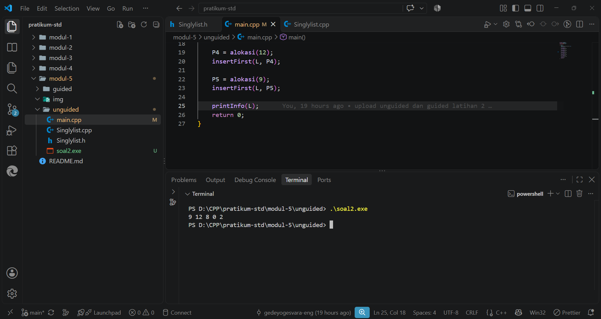
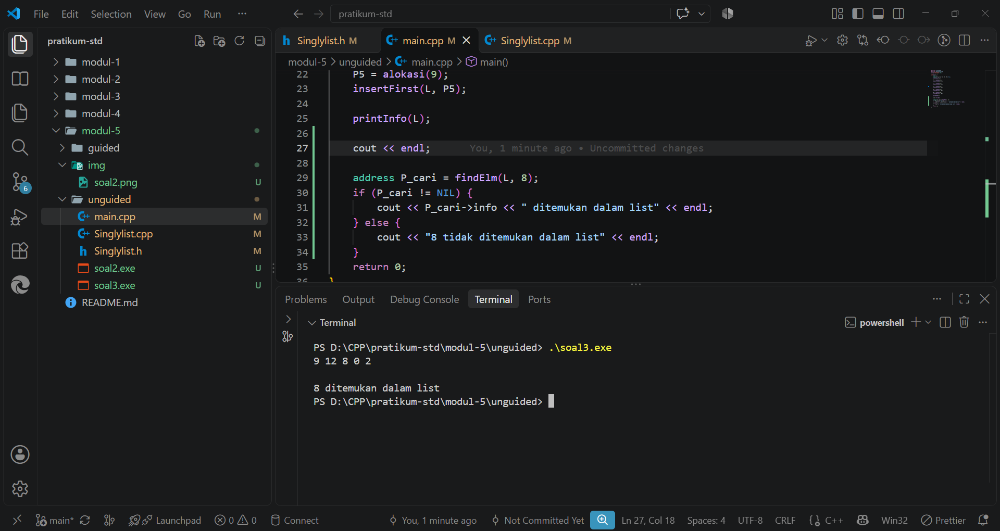
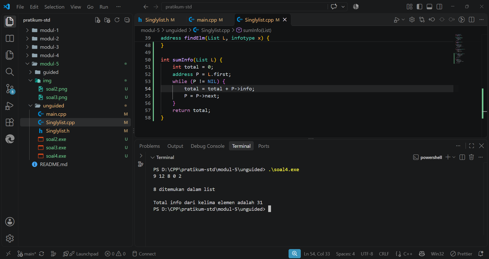

# <h1 align="center">Laporan Praktikum Modul 5 - Singly Linked List (Bagian Kedua)</h1>
<p align="center">Gede Yogi Yogesvara Dita Diasta - 109082500037</p>

## Dasar Teori
Linked list (biasa disebut list saja) adalah salah satu bentuk struktur data berupa serangkaian elemen data yang saling berkait dan bersifat fleksibel karena dapat tumbuh dan mengerut sesuai kebutuhan [1]. Data yang disimpan bisa berupa data tunggal atau data majemuk (record) [1]. Implementasi linked list menggunakan pointer karena sifatnya dinamis dan lebih mudah dalam menangani perubahan ukuran data dibandingkan array yang statis.

### A. Singly Linked List<br/>
Singly Linked List merupakan model ADT linked list yang hanya memiliki satu arah pointer dan hanya dapat melakukan pembacaan maju [1]. Komponennya:
#### 1. First/Head
Pointer pada list yang menunjuk alamat elemen pertama list. Jika list kosong, maka first bernilai Nil atau NULL.
#### 2. Info/Data
Bagian elemen (node) tempat menyimpan informasi atau data utama.
#### 3. Next/Successor
Pointer pada elemen yang berfungsi sebagai penghubung ke alamat elemen di depannya. Node paling akhir akan menunjuk ke Nil.

### B. Operasi pada Singly Linked List (Bagian Kedua)<br/>
Melanjutkan operasi dasar pada modul sebelumnya seperti createList, alokasi, dealokasi, insert, delete, dan printInfo, pada bagian kedua ini membahas operasi pencarian dan pengubahan data:
#### 1. Searching (Pencarian)
Searching merupakan operasi dasar list dengan melakukan pencarian terhadap node tertentu. Proses ini berjalan dengan mengunjungi setiap node dari first secara sekuensial dan berhenti setelah node yang dicari ketemu. Dengan operasi searching, operasi lain seperti insert after, delete after, dan update menjadi lebih mudah dilakukan.
#### 2. Update (Pengubahan Isi Elemen)
Operasi untuk mengubah nilai data info yang ada di dalam node tanpa harus menghapus atau membuat alokasi node baru, baik pada posisi awal updateFirst, akhir updateLast, atauoun setelah node tertentu updateAfter.

---

## Guided 

### 1. Program ADT Daftar Buah dengan Operasi Dasar, Update, dan Searching (`listBuah.h`, `listBuah.cpp`, dan `main.cpp`)

#### File `listBuah.h`
```C++
//Header guard digunakan untuk mencegah file header yang sama 
//di-include lebih dari sekali dalam satu program.
#ifndef LISTBUAH_H
#define LISTBUAH_H
#define Nil NULL

#include<iostream>
using namespace std;

struct buah{
    string nama;
    int jumlah; 
    float harga;
};

typedef buah dataBuah; //Memberikan nama alias databuah untuk struct buah.

typedef struct node *address; //Mendefinisikan alias address sebagai pointer ke struct node

struct node{ // node untuk isi dari linked listnya, isi setiap node adalah data & pointer next
    dataBuah isidata;
    address next;
};

struct linkedlist{ //ini linked list nya
    address first;
};

//semua function & prosedur yang akan dipakai
//Materi modul 4
bool isEmpty(linkedlist List);
void createList(linkedlist &List);
address alokasi(string nama, int jumlah, float harga);
void dealokasi(address &node);
void printList(linkedlist List);
void insertFirst(linkedlist &List, address nodeBaru);
void insertAfter(linkedlist &List, address nodeBaru, address Prev);
void insertLast(linkedlist &List, address nodeBaru);
void delFirst(linkedlist &List);
void delLast(linkedlist &List);
void delAfter(linkedlist &List, address nodeHapus, address nodePrev);
int nbList(linkedlist List);
void deleteList(linkedlist &List);

//materi modul 5 (update)
void updateFirst(linkedlist List);
void updateLast(linkedlist List);
void updateAfter(linkedlist List, address prev);

//materi modul 5 (searching)
void FindNodeByData(linkedlist list, string data);
void FindNodeByAddress(linkedlist list, address node);
void FindNodeByRange(linkedlist list, float hargaAwal, float HargaAkhir);

#endif
```

#### File `listBuah.cpp`
```C++
#include "listBuah.h"
#include <iostream>
using namespace std;

//fungsi untuk cek apakah list kosong atau tidak
bool isEmpty(linkedlist List) {
    if(List.first == Nil){
        return true; 
    } else {
        return false;
    }
}

//pembuatan linked list kosong
void createList(linkedlist &List) {
    List.first = Nil;
}

//pembuatan node baru dengan menerapkan manajemen memori
address alokasi(string nama, int jumlah, float harga) { 
    address nodeBaru = new node; 
    nodeBaru->isidata.nama = nama;
    nodeBaru->isidata.jumlah = jumlah; 
    nodeBaru->isidata.harga = harga;
    nodeBaru->next = Nil;
    return nodeBaru;
}

//penghapusan node dengan menerapkan manajemen memori
void dealokasi(address &node) {
    node->next = Nil;
    delete node;
}

//prosedur-prosedur untuk insert / menambahkan node baru kedalam list
void insertFirst(linkedlist &List, address nodeBaru) {
    nodeBaru->next = List.first; 
    List.first = nodeBaru;
}

void insertAfter(linkedlist &List, address nodeBaru, address Prev) {
    if (Prev != Nil) {
        nodeBaru->next = Prev->next;
        Prev->next = nodeBaru;
    } else {
        cout << "Node sebelumnya tidak valid!" << endl;
    }
}

void insertLast(linkedlist &List, address nodeBaru) {
    if (isEmpty(List)) {
        List.first = nodeBaru;
    } else {
        address nodeBantu = List.first;
        while (nodeBantu->next != Nil) {
            nodeBantu = nodeBantu->next;
        }
        nodeBantu->next = nodeBaru;
    }
}

//prosedur-prosedur untuk delete / menghapus node yang ada didalam list
void delFirst(linkedlist &List){
    address nodeHapus;
    if (isEmpty(List) == false) {
        nodeHapus = List.first;
        List.first = List.first->next;
        nodeHapus->next = Nil;
        dealokasi(nodeHapus);
        cout << "Node pertama berhasil terhapus!" << endl;
    } else {
        cout << "List kosong!" << endl;
    }
}

void delLast(linkedlist &List){
    address nodeHapus, nodePrev;
    if(isEmpty(List) == false){
        nodeHapus = List.first;
        if(nodeHapus->next == Nil){
            List.first->next = Nil;
            dealokasi(nodeHapus);
        } else { 
            while(nodeHapus->next != Nil){
                nodePrev = nodeHapus; 
                nodeHapus = nodeHapus->next;
            }
            nodePrev->next = Nil; 
            dealokasi(nodeHapus);
        }
        cout << "Node terakhir berhasil terhapus!" << endl;
    } else {
        cout << "list kosong" << endl;
    }
}

void delAfter(linkedlist &List, address nodeHapus, address nodePrev){
    if(isEmpty(List) == true){
        cout << "List kosong!" << endl;
    } else { //jika list tidak kosong
        if (nodePrev != Nil && nodePrev->next != Nil) { 
            nodeHapus = nodePrev->next;       
            nodePrev->next = nodeHapus->next;  
            nodeHapus->next = Nil;         
            dealokasi(nodeHapus);
            cout << "Node setelah node " << nodePrev->isidata.nama << " berhasil terhapus!" << endl;
        } else {
            cout << "Node sebelumnya (prev) tidak valid!" << endl;
        }
    }
}

//prosedur untuk menampilkan isi list
void printList(linkedlist List) {
    if (isEmpty(List)) {
        cout << "List kosong." << endl;
    } else {
        address nodeBantu = List.first;
        while (nodeBantu != Nil) { 
            cout << "Nama Buah : " << nodeBantu->isidata.nama << ", Jumlah : " << nodeBantu->isidata.jumlah << ", Harga : " << nodeBantu->isidata.harga << endl;
            nodeBantu = nodeBantu->next;
        }
    }
}

//function untuk menampilkan jumlah node didalam list
int nbList(linkedlist List) {
    int count = 0;
    address nodeBantu = List.first;
    while (nodeBantu != Nil) {
        count++;
        nodeBantu = nodeBantu->next; 
    }
    return count;
}

//prosedur untuk menghapus list (menghapus semua node didalam list)
void deleteList(linkedlist &List){
    address nodeBantu, nodeHapus;
    nodeBantu = List.first;
    while(nodeBantu != Nil){
        nodeHapus = nodeBantu;
        nodeBantu = nodeBantu->next;
        dealokasi(nodeHapus); 
    }
    List.first = Nil; 
    cout << "List berhasil terhapus!" << endl;
}

/*----- MATERI PERTEMUAN 5 - SINGLY LINKED LIST (BAGIAN KEDUA) - UPDATE -----*/
//prosedur-prosedur untuk melakukan update data node
void updateFirst(linkedlist List){
    if(isEmpty(List) == true){
        cout << "List kosong!" << endl;
    } else {
        cout << "Masukkan update data node pertama : " << endl;
        cout << "Nama buah : ";
        cin >> List.first->isidata.nama;
        cout << "Jumlah : ";
        cin >> List.first->isidata.jumlah;
        cout << "Harga : ";
        cin >> List.first->isidata.harga;
        cout << "Data Berhasil Diupdate!" << endl;
        cout << endl;
    }
}

void updateLast(linkedlist List){
    if (isEmpty(List) == true) {
        cout << "List Kosong!" << endl;
    } else {
        address nodeBantu = List.first;
        while (nodeBantu->next != Nil) {
            nodeBantu = nodeBantu->next;
        }
        cout << "masukkan update data node terakhir : " << endl;
        cout << "Nama buah : ";
        cin >> nodeBantu->isidata.nama;
        cout << "Jumlah : ";
        cin >> nodeBantu->isidata.jumlah;
        cout << "Harga : ";
        cin >> nodeBantu->isidata.harga;
        cout << "Data Berhasil Diupdate!" << endl;
        cout << endl;
    }
}

void updateAfter(linkedlist List, address nodePrev){
    if(isEmpty(List) == true){
        cout << "List kosong!" << endl;
    } else {
        if (nodePrev != Nil && nodePrev->next != Nil){
            address nodeBantu = nodePrev->next;
            cout << "masukkan update data node setelah node " << nodePrev->isidata.nama << " : " << endl;
            cout << "Nama buah : ";
            cin >> nodeBantu->isidata.nama;
            cout << "Jumlah : ";
            cin >> nodeBantu->isidata.jumlah;
            cout << "Harga : ";
            cin >> nodeBantu->isidata.harga;
            cout << "Data Berhasil Diupdate!" << endl;
            cout << endl;
        } else {
            cout << "Node sebelumnya (prev) tidak valid!" << endl;
        }
    }
}

/*----- MATERI PERTEMUAN 5 - SINGLY LINKED LIST (BAGIAN KEDUA) - SEARCHING -----*/
//prosedur-prosedur untuk searching data
//prosedur untuk mencari node berdasarkan data
void FindNodeByData(linkedlist list, string data){
    if(isEmpty(list) == true){
        cout << "List kosong!" << endl;
    } else {
        address nodeBantu = list.first;
        int posisi = 0;
        bool found = false;
        while(nodeBantu != Nil){
            posisi++;
            if(nodeBantu->isidata.nama == data){
                cout << "Data " << data << " ditemukan pada posisi ke-" << posisi << "!" << endl;
                cout << "Nama Buah : " << nodeBantu->isidata.nama << ", Jumlah : " << nodeBantu->isidata.jumlah << ", Harga : " << nodeBantu->isidata.harga << endl;
                found = true;
                break;
            }
            nodeBantu = nodeBantu->next;
        }
        if(found == false){
            cout << "Node dengan data " << data << " tidak ditemukan!" << endl;
        }
    }
    cout << endl;
}

//prosedur untuk mencari node berdasarkan alamat node
void FindNodeByAddress(linkedlist list, address node) {
    if(isEmpty(list) == true) {
        cout << "List kosong!" << endl;
    } else {
        address nodeBantu = list.first;
        int posisi = 0;
        bool found = false;
        while (nodeBantu != Nil) {
            posisi++;
            if(nodeBantu == node) {
                cout << "Node ditemukan pada posisi ke-" << posisi << "!" << endl;
                cout << "Alamat node : " << nodeBantu << endl;
                cout << "Nama Buah : " << nodeBantu->isidata.nama << ", Jumlah : " << nodeBantu->isidata.jumlah << ", Harga : " << nodeBantu->isidata.harga << endl;
                found = true;
                break;
            }
            nodeBantu = nodeBantu->next;
        }
        if(found == false) {
            cout << "Node dengan alamat " << node << " tidak ditemukan dalam list!" << endl;
        }
    }
    cout << endl;
}

//prosedur untuk mencari node berdasarkan range data (range harga)
void FindNodeByRange(linkedlist list, float hargaAwal, float hargaAkhir) {
    if(isEmpty(list) == true) {
        cout << "List kosong!" << endl;
    } else {
        address nodeBantu = list.first;
        int posisi = 0;
        bool found = false;
        cout << "--- Buah dalam range harga " << hargaAwal << " - " << hargaAkhir << " ---" << endl;
        cout << "-------------------------------------------" << endl;
        while (nodeBantu != Nil) {
            posisi++;
            float harga = nodeBantu->isidata.harga;
            if(harga >= hargaAwal && harga <= hargaAkhir) {
                cout << "Data ditemukan pada posisi ke-" << posisi << " :" << endl;
                cout << "Nama Buah : " << nodeBantu->isidata.nama << ", Jumlah : " << nodeBantu->isidata.jumlah << ", Harga : " << nodeBantu->isidata.harga << endl;
                cout << "-------------------------------------------" << endl;
                found = true;
            }
            nodeBantu = nodeBantu->next;
        }
        if(found == false) {
            cout << "Tidak ada data buah dalam range harga tersebut!" << endl;
            cout << "-------------------------------------------" << endl;
        }
    }
    cout << endl;
}
```

#### File `main.cpp`
```C++
#include "listBuah.h"
#include <iostream>
using namespace std;

int main() {
    // 1. Buat list kosong
    linkedlist daftarBuah;
    createList(daftarBuah);

    // 2. Tambahkan data untuk testing
    cout << "--- Menambahkan Data Buah ---" << endl;
    address buah1 = alokasi("Apel", 10, 15000);
    insertFirst(daftarBuah, buah1);

    address buah2 = alokasi("Jeruk", 5, 20000);
    insertLast(daftarBuah, buah2);
    
    address buah3 = alokasi("Mangga", 12, 12000);
    insertFirst(daftarBuah, buah3);

    // 3. Tampilkan list
    printList(daftarBuah);
    cout << "Jumlah buah di list: " << nbList(daftarBuah) << "\n\n";

    // 4. Test searching
    cout << "--- Test Pencarian ---" << endl;
    FindNodeByData(daftarBuah, "Jeruk");

    // 5. Bersihkan memori sebelum program selesai
    deleteList(daftarBuah);

    return 0; // Wajib ada untuk menandakan program selesai tanpa error
}
```

**Penjelasan Singkat Guided:**
Program di atas merupakan implementasi Singly Linked List untuk menyimpan data buah nama, jumlah, dan harga. Selain operasi dasar pembuatan list, insert, dan delete dari Modul 4, di Modul 5 ini ditambahkan fitur update updateFirst, updateLast, updateAfter untuk mengubah isi data langsung dari input user, serta fitur searching FindNodeByData, FindNodeByAddress, FindNodeByRange yang menelusuri node dari first sampai Nil menggunakan pointer bantuan nodeBantu. Di main.cpp program menguji penambahan 3 data buah, mencetak list dan jumlah elemennya, mencari buah "Jeruk", lalu menghapus seluruh list di akhir program.

---

## Unguided 

### 1. Buatlah ADT Singly Linked List di dalam file "Singlylist.h" dan implementasinya pada file "Singlylist.cpp", kemudian uji sesuai ilustrasi elemen 9 -> 12 -> 8 -> 0 -> 2, carilah elemen dengan info 8 menggunakan fungsi findElm, serta hitunglah jumlah total info seluruh elemen 9+12+8+0+2=31.

#### File Singlylist.h
```C++
#ifndef SINGLYLIST_H_INCLUDED
#define SINGLYLIST_H_INCLUDED
#include <iostream>
#define NIL NULL
using namespace std;

typedef int infotype;
typedef struct ElmList *address;

struct ElmList {
    infotype info;
    address next;
};

struct List {
    address first;
};

void createList(List &L);
address alokasi(infotype x);
void dealokasi(address &P);
void printInfo(List L);
void insertFirst(List &L, address P);

address findElm(List L, infotype x);

int sumInfo(List L);

#define createlist createList
#endif
```

#### File Singlylist.cpp
```C++
#include "Singlylist.h"

void createList(List &L) {
    L.first = NIL;
}

address alokasi(infotype x) {
    address P = new ElmList;
    if (P != NIL) {
        P->info = x;
        P->next = NIL;
    }
    return P;
}

void dealokasi(address &P) {
    delete P;
    P = NIL;
}

void printInfo(List L) {
    address P = L.first;
    while (P != NIL) {
        cout << P->info << " ";
        P = P->next;
    }
    cout << endl;
}

void insertFirst(List &L, address P) {
    if (L.first == NIL) {
        L.first = P;
    } else {
        P->next = L.first;
        L.first = P;
    }
}

address findElm(List L, infotype x) {
    address P = L.first;
    while (P != NIL) {
        if (P->info == x) {
            return P;
        }
        P = P->next;
    }
    return NIL;
}

int sumInfo(List L) {
    int total = 0;
    address P = L.first;
    while (P != NIL) {
        total = total + P->info;
        P = P->next;
    }
    return total;
}
```

#### File main.cpp
```C++
#include <iostream>
#include "Singlylist.h"
using namespace std;

int main() {
    List L;
    address P1, P2, P3, P4, P5 = NIL;
    createList(L);
    
    P1 = alokasi(2);
    insertFirst(L, P1);

    P2 = alokasi(0);
    insertFirst(L, P2);

    P3 = alokasi(8);
    insertFirst(L, P3);

    P4 = alokasi(12);
    insertFirst(L, P4);

    P5 = alokasi(9);
    insertFirst(L, P5);

    printInfo(L);

    cout << endl;

    address P_cari = findElm(L, 8);
    if (P_cari != NIL) {
        cout << P_cari->info << " ditemukan dalam list" << endl;
    } else {
        cout << "8 tidak ditemukan dalam list" << endl;
    }

    cout << endl;

    int total = sumInfo(L);
    cout << "Total info dari kelima elemen adalah " << total << endl;
    return 0;
}
```

### Output Unguided :

##### Output 1


##### Output 2


##### Output 3


**Penjelasan Unguided:**

1. Soal 2 agar urutan list sesuai gambar di modul 9 -> 12 -> 8 -> 0 -> 2, data dimasukkan menggunakan insertFirst dari urutan paling belakang yaitu 2, 0, 8, 12, lalu 9. Prosedur printInfo(L) kemudian menelusuri list dari L.first sampai NIL dan mencetak tiap nilai info
2. Soal 3 findElm fungsi ini dipakai untuk mencari elemen bernilai x 8. Pointer P mengecek node satu per satu dari L.first. Saat P->info == 8, fungsi langsung mengembalikan alamat P lalu di main.cpp dicetak pesan "8 ditemukan dalam list".
3. Soal 4 sumInfo fungsi ini menjumlahkan seluruh info pada list menggunakan variabel total yang diinisialisasi 0. Selama P != NIL, nilai P->info ditambahkan ke total 9 + 12 + 8 + 0 + 2 lalu menghasilkan nilai balik 31.

---

## Kesimpulan
Dari praktikum Modul 5 ini penerapan ADT Singly Linked List pada C++ dilakukan dengan memisahkan deklarasi tipe data dan prototipe fungsi di file .h, implementasi fungsi di file .cpp, dan juga pemanggilan program di main.cpp. Lalu penyisipan dengan insertFirst selalu menempatkan elemen baru di awal list sehingga elemen yang terakhir dimasukkan akan berada di posisi paling depan dan operasi searching menggunakan findElm dan perhitungan jumlah elemen menggunakan sumInfo sama sama dilakukan dengan menelusuri list dari first ke elemen berikutnya sampai mencapai Nil

---

## Referensi
[1] Tim Asisten Praktikum. (2024). *Modul 4 & Modul 5 Praktikum Struktur Data: Singly Linked List*. Purwokerto: Fakultas Informatika, Telkom University.