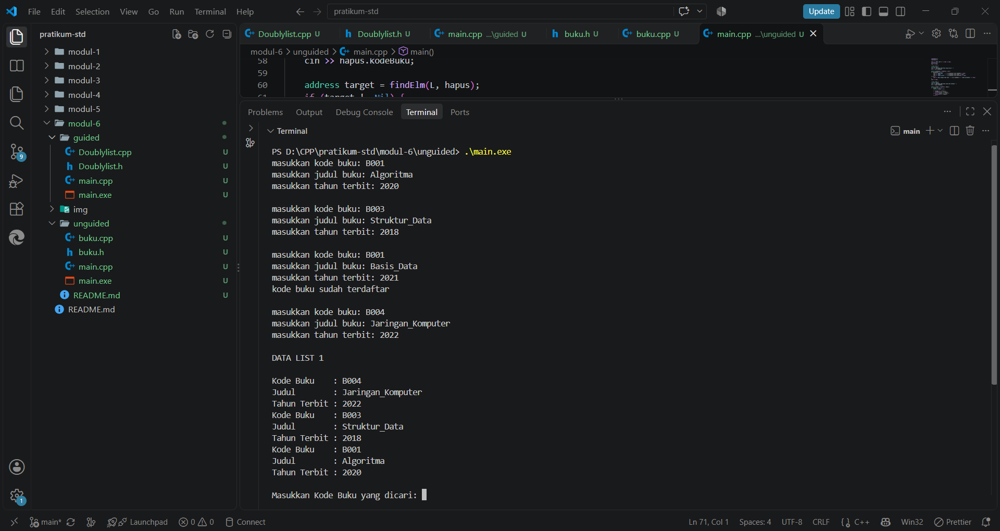
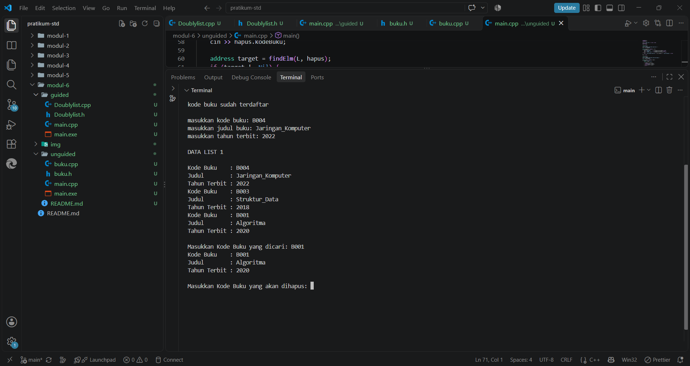
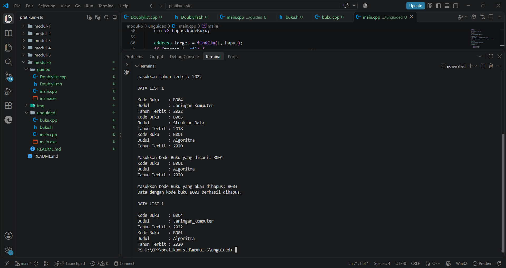

# Praktikum-STD-Modul06
# <h1 align="center">Laporan Praktikum Modul 6 - Doubly Linked List (Bagian Pertama)</h1>
<p align="center">Gede Yogi Yogesvara Dita Diasta - 109082500037</p>

## Dasar Teori
### A. Doubly Linked List
Doubly Linked List adalah linked list yang setiap elemennya memiliki 2 successor, yaitu prev yang menunjuk ke elemen sebelumnya dan next yang menunjuk ke elemen sesudahnya. List ini juga menggunakan 2 pointer utama, yaitu first yang menunjuk ke elemen pertama dan last yang menunjuk ke elemen terakhir. List dikatakan kosong jika L.first = Nil.

### B. Insert
Insert pada Doubly Linked List ada 4 macam, yaitu insert first, insert last, insert after, dan insert before. Insert first menambah elemen di depan list dengan cara P->next diarahkan ke L.first, lalu (L.first)->prev = P, dan terakhir L.first = P. Insert last menambah elemen di belakang list dengan cara P->prev = L.last, lalu (L.last)->next = P, dan terakhir L.last = P. Insert after menyisipkan elemen baru setelah elemen R, sedangkan insert before kebalikannya, perbedaannya hanya pada pencarian elemennya.

### C. Delete
Delete juga ada 4 macam, yaitu delete first, delete last, delete after, dan delete before. Pada delete first, P = L.first, lalu first dipindah ke elemen berikutnya dan prev dari first yang baru diisi Nil. Pada delete last, P = L.last, lalu last dipindah ke elemen sebelumnya dan next dari last yang baru diisi Nil. Pada delete after, R->next = P->next dan (P->next)->prev = R, sehingga P terlepas dari list. Setelah terlepas, elemen P bisa dikembalikan atau didealokasi. Delete before kebalikan dari delete after.

### D. Update, View, dan Searching
Proses update, view, dan searching pada dasarnya sama dengan Singly Linked List. Bedanya, pada Doubly Linked List akses elemen lebih mudah karena penelusuran bisa dilakukan maju maupun mundur.

## Guided 

### 1. Latihan 1 - Pembuatan ADT dan Insert Last

**Doublylist.h**
```C++
#ifndef DOUBLYLIST_H
#define DOUBLYLIST_H

#include <iostream>
#include <string>

#define Nil NULL

// Latihan 1
struct infotype {
    std::string nopol; 
    std::string warna; 
    int thnBuat;      
};
typedef struct elmlist *address;
struct elmlist {
    infotype info;  
    address next;   
    address prev;   
};
struct List {
    address First; 
    address Last;  
};


// Latihan 1
void CreateList(List &L);
address alokasi(infotype x);
void dealokasi(address &P);
void printInfo(List L);
void insertLast(List &L, address P);

// Latihan 2

address findElm(List L, std::string nopol);

// Latihan 3
void deleteFirst(List &L, address &P);
void deleteLast(List &L, address &P);
void deleteAfter(List &L, address Prec, address &P);
void deleteElm(List &L, std::string nopol, bool &status);

#endif
```

**Doublylist.cpp**
```C++
#include "Doublylist.h"

// Latihan 1
void CreateList(List &L) {
    L.First = Nil;
    L.Last = Nil;
}

address alokasi(infotype x) {
    address P = new elmlist;
    P->info = x;
    P->next = Nil;
    P->prev = Nil; 
    return P;
}

void dealokasi(address &P) {
    delete P;
}

void printInfo(List L) {
    address P = L.Last;
    if (P == Nil) {
        std::cout << "List kosong." << std::endl;
        return;
    }
    while (P != Nil) {
        std::cout << "no polisi : " << P->info.nopol << std::endl;   
        std::cout << "warna     : " << P->info.warna << std::endl;   
        std::cout << "tahun     : " << P->info.thnBuat << std::endl; 
        P = P->prev;
    }
}

void insertLast(List &L, address P) {
    if (L.First == Nil) { 
        L.First = P;
        L.Last = P;
    } else {
        P->prev = L.Last;         
        (L.Last)->next = P;     
        L.Last = P;               
    }
}
```

**main.cpp**
```C++
#include <iostream>
#include "Doublylist.h"
using namespace std;

void inputData(List &L) {
    infotype data;
    address P;

    cout << "masukkan nomor polisi: "; cin >> data.nopol;
    cout << "masukkan warna kendaraan: "; cin >> data.warna;
    cout << "masukkan tahun kendaraan: "; cin >> data.thnBuat;
    if (findElm(L, data.nopol) == Nil) {
        P = alokasi(data); 
        insertLast(L, P);  
    } else {
        cout << "nomor polisi sudah terdaftar" << endl; 
    }
}

int main() {
    List L;
    CreateList(L); 
    address P;

    // Latihan 1
    inputData(L); 
    inputData(L); 
    inputData(L); 
    inputData(L); 

    cout << "\nDATA LIST 1" << endl; 
    printInfo(L); 

    // Latihan 2
    string nopolCari;
    cout << "\nMasukkan Nomor Polisi yang dicari : "; 
    cin >> nopolCari; 
    
    P = findElm(L, nopolCari); 
    if (P != Nil) {
        cout << "Nomor Polisi : " << P->info.nopol << endl; 
        cout << "Warna        : " << P->info.warna << endl; 
        cout << "Tahun        : " << P->info.thnBuat << endl; 
    } else {
        cout << "Data dengan nomor polisi " << nopolCari << " tidak ditemukan." << endl;
    }

    // Latihan 3
    string nopolHapus;
    bool hapusBerhasil;
    cout << "\nMasukkan Nomor Polisi yang akan dihapus : ";
    cin >> nopolHapus;

    deleteElm(L, nopolHapus, hapusBerhasil); 

    if (hapusBerhasil) {
        cout << "Data dengan nomor polisi " << nopolHapus << " berhasil dihapus." << endl; 
    } else {
        cout << "Data dengan nomor polisi " << nopolHapus << " tidak ditemukan." << endl;
    }
    cout << "\nDATA LIST 1" << endl; 
    printInfo(L); 

    return 0;
}
```
Latihan ini membuat ADT doubly linked list untuk data kendaraan yang berisi nopol, warna, dan thnBuat. Fungsi CreateList membuat list kosong, alokasi membuat elemen baru, dealokasi menghapus elemen dari memori, dan insertLast memasukkan elemen di akhir list. Pada printInfo data dicetak dari last ke first memakai pointer prev, jadi urutan tampilnya terbalik dari urutan input. Di main.cpp, sebelum data dimasukkan dicek dulu dengan findElm supaya nomor polisi tidak ganda.

### 2. Latihan 2 - Pencarian Elemen (findElm)
```C++
address findElm(List L, std::string nopol) {
    address P = L.First;
    while (P != Nil) {
        if (P->info.nopol == nopol) {
            return P;
        }
        P = P->next;
    }
    return Nil;
}
```
Fungsi findElm menelusuri list dari first memakai pointer next dan membandingkan nopol tiap elemen dengan nopol yang dicari. Kalau ketemu langsung dikembalikan address elemennya, kalau sampai akhir tidak ketemu dikembalikan Nil.

### 3. Latihan 3 - Penghapusan Elemen (Delete)
```C++
void deleteFirst(List &L, address &P) {
    if (L.First == Nil) return;

    P = L.First; 
    if (L.First == L.Last) { 
        L.First = Nil;
        L.Last = Nil;
    } else {
        L.First = P->next;     
        (L.First)->prev = Nil; 
        P->next = Nil;         
    }
}

void deleteLast(List &L, address &P) {
    if (L.First == Nil) return;

    P = L.Last; 
    if (L.First == L.Last) { 
        L.First = Nil;
        L.Last = Nil;
    } else {
        L.Last = P->prev;      
        (L.Last)->next = Nil; 
        P->prev = Nil;         
    }
}

void deleteAfter(List &L, address Prec, address &P) {
    if (Prec == Nil || Prec->next == Nil) return;

    P = Prec->next;
    if (P == L.Last) {
        deleteLast(L, P);
    } else {
        Prec->next = P->next;     
        (P->next)->prev = Prec; 
        P->next = Nil;            
        P->prev = Nil;           
    }
}

void deleteElm(List &L, std::string nopol, bool &status) {
    address P = findElm(L, nopol);
    status = false;

    if (P != Nil) {
        if (P == L.First) {
            deleteFirst(L, P);
        } else if (P == L.Last) {
            deleteLast(L, P);
        } else {
            address Prec = P->prev;
            deleteAfter(L, Prec, P);
        }
        dealokasi(P); 
        status = true;
    }
}
```
Latihan ini menghapus elemen berdasarkan nopol. deleteFirst dan deleteLast memperhatikan kondisi kalau list hanya punya satu elemen, maka first dan last menjadi Nil. deleteAfter melepas elemen setelah Prec dengan menyambungkan pointer next dan prev elemen di sebelahnya. Prosedur deleteElm mencari elemen dengan findElm, memilih jenis delete sesuai posisinya (awal, akhir, atau tengah), lalu elemen didealokasi dan status hapus diisi true.

## Unguided 

### 1. Pembuatan ADT Dasar dan Insert Data
Buatlah ADT Doubly Linked List untuk data buku di dalam file "Buku.h" beserta implementasinya pada "Buku.cpp" dan cobalah pada "main.cpp". Pastikan sistem melakukan pengecekan duplikasi kodeBuku sebelum memasukkan data baru ke dalam list.

**buku.h**
```C++
#ifndef BUKU_H_INCLUDED
#define BUKU_H_INCLUDED

#include <iostream>
#include <string>

#define Nil NULL

using namespace std;

//soal nomer 1
struct buku {
    string kodeBuku;
    string judul;
    int thnTerbit;
};

typedef buku infotype;
typedef struct ElmList *address;

struct ElmList {
    infotype info;
    address next;
    address prev;
};

struct List {
    address First;
    address Last;
};

void CreateList(List &L);
address alokasi(infotype x);
void dealokasi(address &P);
void printInfo(List L);
void insertLast(List &L, address P);

//soal nomer 2
address findElm(List L, infotype x);

//soal nomer 3
void deleteFirst(List &L, address &P);
void deleteLast(List &L, address &P);
void deleteAfter(address Prec, address &P);

#endif
```

**buku.cpp**
```C++
#include "Buku.h"

//soal nomer 1
void CreateList(List &L) {
    L.First = Nil;
    L.Last = Nil;
}

address alokasi(infotype x) {
    address P = new ElmList;
    P->info = x;
    P->next = Nil;
    P->prev = Nil;
    return P;
}

void dealokasi(address &P) {
    delete P;
    P = Nil;
}

void printInfo(List L) {
    address P = L.Last;
    if (P == Nil) {
        cout << "List kosong." << endl;
        return;
    }
    while (P != Nil) {
        cout << "Kode Buku    : " << P->info.kodeBuku << endl;
        cout << "Judul        : " << P->info.judul << endl;
        cout << "Tahun Terbit : " << P->info.thnTerbit << endl;
        P = P->prev;
    }
}

void insertLast(List &L, address P) {
    if (L.First == Nil) {
        L.First = P;
        L.Last = P;
    } else {
        P->prev = L.Last;
        (L.Last)->next = P;
        L.Last = P;
    }
}

//soal nomer 2
address findElm(List L, infotype x) {
    address P = L.First;
    while (P != Nil) {
        if (P->info.kodeBuku == x.kodeBuku) {
            return P;
        }
        P = P->next;
    }
    return Nil;
}

//soal nomer 3
void deleteFirst(List &L, address &P) {
    if (L.First == Nil) return;

    P = L.First;
    if (L.First == L.Last) {
        L.First = Nil;
        L.Last = Nil;
    } else {
        L.First = P->next;
        (L.First)->prev = Nil;
        P->next = Nil;
    }
}

void deleteLast(List &L, address &P) {
    if (L.First == Nil) return;

    P = L.Last;
    if (L.First == L.Last) {
        L.First = Nil;
        L.Last = Nil;
    } else {
        L.Last = P->prev;
        (L.Last)->next = Nil;
        P->prev = Nil;
    }
}

void deleteAfter(address Prec, address &P) {
    if (Prec == Nil || Prec->next == Nil) return;

    P = Prec->next;
    Prec->next = P->next;
    if (P->next != Nil) {
        (P->next)->prev = Prec;
    }
    P->next = Nil;
    P->prev = Nil;
}
```

**main.cpp**
```C++
#include <iostream>
#include "Buku.h"

using namespace std;

void inputData(List &L) {
    infotype dataBuku;
    address P;

    cout << "masukkan kode buku: ";
    cin >> dataBuku.kodeBuku;
    cout << "masukkan judul buku: ";
    cin >> dataBuku.judul;
    cout << "masukkan tahun terbit: ";
    cin >> dataBuku.thnTerbit;

    if (findElm(L, dataBuku) == Nil) {
        P = alokasi(dataBuku);
        insertLast(L, P);
    } else {
        cout << "kode buku sudah terdaftar" << endl;
    }
    cout << endl;
}

int main() {
    List L;
    CreateList(L);

    //soal nomer 1
    inputData(L);
    inputData(L);
    inputData(L);
    inputData(L);

    cout << "DATA LIST 1" << endl << endl;
    printInfo(L);
    cout << endl;

    //soal nomer 2
    infotype cari;
    cout << "Masukkan Kode Buku yang dicari: ";
    cin >> cari.kodeBuku;

    address ditemukan = findElm(L, cari);
    if (ditemukan != Nil) {
        cout << "Kode Buku    : " << ditemukan->info.kodeBuku << endl;
        cout << "Judul        : " << ditemukan->info.judul << endl;
        cout << "Tahun Terbit : " << ditemukan->info.thnTerbit << endl;
    } else {
        cout << "Data dengan kode buku " << cari.kodeBuku << " tidak ditemukan." << endl;
    }
    cout << endl;

    //soal nomer 3
    infotype hapus;
    cout << "Masukkan Kode Buku yang akan dihapus: ";
    cin >> hapus.kodeBuku;

    address target = findElm(L, hapus);
    if (target != Nil) {
        address P_hapus = Nil;

        if (target == L.First) {
            deleteFirst(L, P_hapus);
        } else if (target == L.Last) {
            deleteLast(L, P_hapus);
        } else {
            deleteAfter(target->prev, P_hapus);
        }

        dealokasi(P_hapus);
        cout << "Data dengan kode buku " << hapus.kodeBuku << " berhasil dihapus." << endl << endl;
    } else {
        cout << "Data dengan kode buku " << hapus.kodeBuku << " tidak ditemukan." << endl << endl;
    }

    cout << "DATA LIST 1" << endl << endl;
    printInfo(L);

    return 0;
}
```
### Output Unguided 1 :


penjelasan unguided 1
Program ini membuat doubly linked list untuk data buku yang berisi kodeBuku, judul, dan thnTerbit. Elemen baru dimasukkan di akhir list dengan insertLast. Sebelum dimasukkan, kodeBuku dicek dulu dengan findElm, kalau sudah ada maka muncul pesan "kode buku sudah terdaftar" dan data tidak dimasukkan. Untuk menampilkan data, printInfo berjalan dari last ke first lewat pointer prev sehingga hasilnya tercetak terbalik dari urutan input.

### 2. Pencarian Elemen (Searching)
Carilah elemen dengan kode buku B001 dengan membuat fungsi baru findElm(L : List, x : infotype) : address.

```C++
address findElm(List L, infotype x) {
    address P = L.First;
    while (P != Nil) {
        if (P->info.kodeBuku == x.kodeBuku) {
            return P;
        }
        P = P->next;
    }
    return Nil;
}
```
### Output Unguided 2 :


penjelasan unguided 2
Fungsi findElm berjalan dari first lewat pointer next dan membandingkan kodeBuku tiap elemen dengan kode yang dicari. Jika ketemu dikembalikan address elemennya, jika tidak ketemu dikembalikan Nil. Di main.cpp, kalau hasilnya bukan Nil maka data buku ditampilkan, kalau Nil maka muncul pesan data tidak ditemukan.

### 3. Penghapusan Elemen (Delete)
Hapus elemen dengan kode buku B003 dengan membuat prosedur deleteFirst, deleteLast, dan deleteAfter.

```C++
void deleteFirst(List &L, address &P) {
    if (L.First == Nil) return;

    P = L.First;
    if (L.First == L.Last) {
        L.First = Nil;
        L.Last = Nil;
    } else {
        L.First = P->next;
        (L.First)->prev = Nil;
        P->next = Nil;
    }
}

void deleteLast(List &L, address &P) {
    if (L.First == Nil) return;

    P = L.Last;
    if (L.First == L.Last) {
        L.First = Nil;
        L.Last = Nil;
    } else {
        L.Last = P->prev;
        (L.Last)->next = Nil;
        P->prev = Nil;
    }
}

void deleteAfter(address Prec, address &P) {
    if (Prec == Nil || Prec->next == Nil) return;

    P = Prec->next;
    Prec->next = P->next;
    if (P->next != Nil) {
        (P->next)->prev = Prec;
    }
    P->next = Nil;
    P->prev = Nil;
}
```
### Output Unguided 3 :


penjelasan unguided 3
Elemen yang mau dihapus dicari dulu dengan findElm, lalu dilihat posisinya. Kalau di awal dipakai deleteFirst, kalau di akhir dipakai deleteLast, dan kalau di tengah dipakai deleteAfter dengan Prec berupa elemen sebelumnya (target->prev). Setelah dilepas dari list, elemen didealokasi. Pada contoh, B003 berada di tengah sehingga dihapus dengan deleteAfter, dan list tersisa B004 dan B001.

## Kesimpulan
Dari praktikum modul 6 ini mempelajari konsep doubly linked list, yaitu list yang tiap elemennya punya pointer next dan prev serta list yang punya pointer first dan last. Praktikum ini mencakup insert last, pencarian elemen dengan findElm, dan penghapusan elemen dengan deleteFirst, deleteLast, dan deleteAfter. Dengan adanya pointer prev, elemen bisa diakses dari depan maupun belakang dan proses penghapusan jadi lebih mudah dilakukan.

## Referensi
[1] Telkom University. (2026). *Modul 6: Doubly Linked List (Bagian Pertama)*. Modul Praktikum Struktur Data. Fakultas Informatika, Telkom University Purwokerto.
