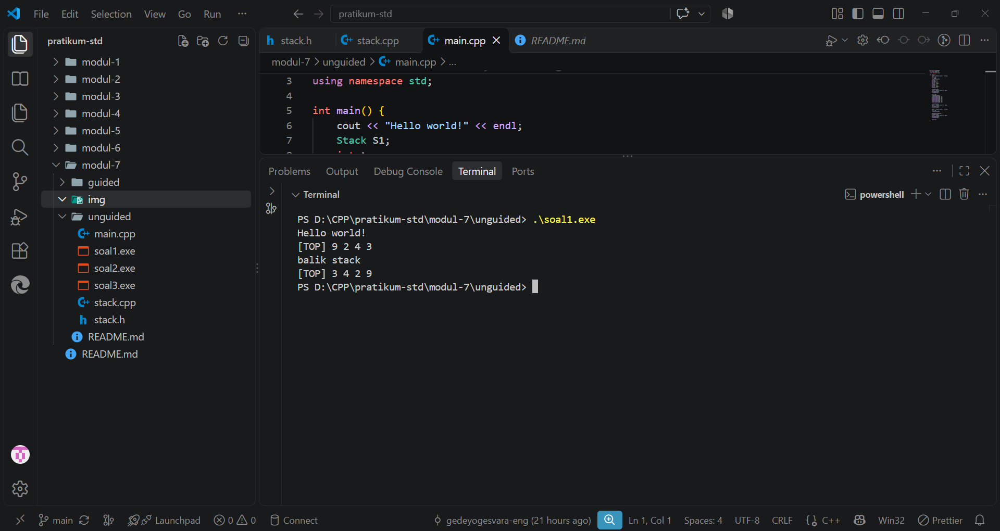
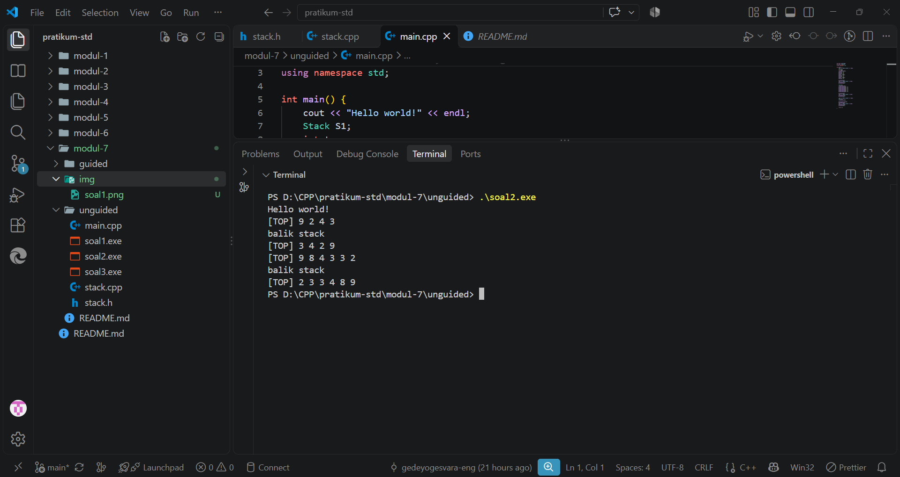
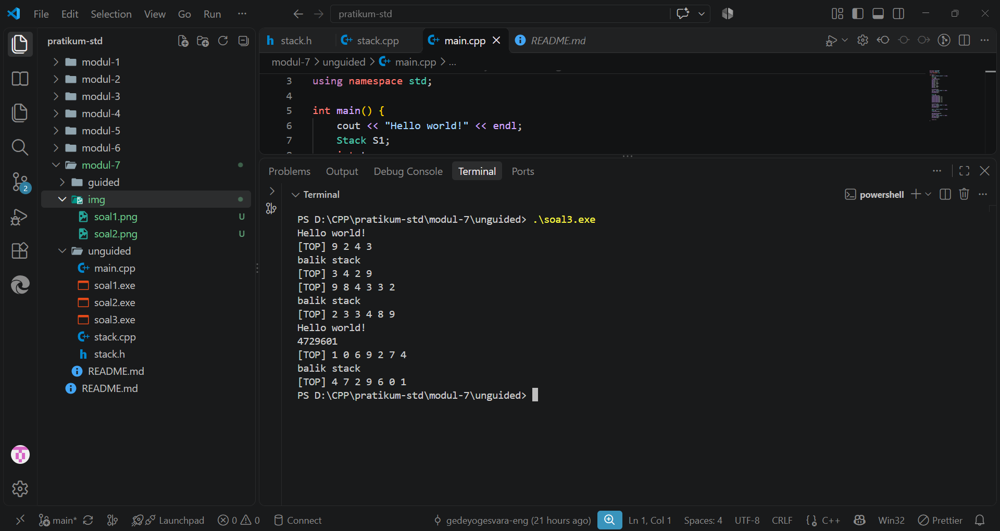

# <h1 align="center">Laporan Praktikum Modul 7 - STACK</h1>
<p align="center">Gede Yogi Yogesvara Dita Diasta - 109082500037</p>

## Dasar Teori

### A. Stack<br/>
Stack adalah struktur data yang cara kerjanya mirip tumpukan barang. Elemen yang bisa diambil lebih dulu adalah elemen yang paling atas yaitu elemen yang terakhir dimasukkan. Prinsip ini disebut LIFO (Last In First Out). Untuk akses ke stack hanya lewat satu titik saja yang namanya Top jadi kita tidak bisa langsung mengambil atau menyisipkan elemen di tengah tumpukan atau stack.

#### 1. Komponen Stack
Komponen stack pada dasarnya sama dengan singly linked list bedanya akses hanya dilakukan di awal stack saja Top. Kalau stack kosong maka Top menunjuk ke Nil atau bernilai 0.

#### 2. Representasi Stack
Stack bisa dibuat dengan dua cara. Cara pertama pakai pointer di mana setiap elemen punya info dan pointer next sehingga ukurannya fleksibel. Cara kedua pakai tabel array berindeks yang kapasitasnya terbatas sesuai ukuran array dan tidak perlu manajemen memori seperti alokasi dan dealokasi.

### B. Operasi pada Stack<br/>
Ada dua operasi utama pada stack yaitu Push dan Pop.
#### 1. Push
Push adalah operasi menyisipkan elemen ke dalam stack. Pada representasi tabel Top digeser dulu ke indeks berikutnya Top = Top + 1 baru data dimasukkan operasi ini mirip insert first pada list biasa.

#### 2. Pop
Pop adalah operasi mengambil elemen yang ada di posisi Top. Setelah datanya diambil Top bergeser satu indeks ke bawah Top = Top - 1. Operasi ini mirip delete first pada list linear.

### C. Primitif pada Stack<br/>
Primitif adalah fungsi atau prosedur dasar yang dipakai untuk mengelola stack misal createStack() untuk membuat stack kosong dan isEmpty() untuk mengecek apakah stack kosong. Primitif tersimpan pada file .h untuk prototype dan file .cpp untuk implementasinya.

## Guided 

Guided pada modul ini menggunakan stack representasi tabel array dengan tipe data infotype berupa struct yang menyimpan nim dan nama. Kapasitas stack maksimal 10 data.

### 1. stack.h

```C++
/* file : stack.h
   contoh ADT stack dengan representasi tabel */
#ifndef STACK_H_INCLUDED
#define STACK_H_INCLUDED

#include <iostream>
using namespace std;

struct infotype {
    char nim[20];
    char nama[20];
};
struct Stack {
    infotype info[10];
    int Top;
};

/* prototype */
/******** pengecekan apakah Stack kosong *********/
int isEmpty(Stack S);
/* mengembalikan nilai 0 jika stack kosong */

/******** pembuatan Stack ********/
void createStack(Stack &S);
/* I.S. sembarang
   F.S. terbentuk stack dengan Top=0 */

/******** penambahan elemen pada Stack ********/
void push(Stack &S, infotype X);
/* I.S. Stack mungkin kosong
   F.S. menambahkan elemen pada stack dengan nilai X, TOP=TOP+1 */

/******** penghapusan elemen pada Stack ********/
void pop(Stack &S, infotype &X);
/* I.S. stack tidak kosong
   F.S. nilai info pada indeks TOP disimpan pada X, kemudian TOP=TOP-1 */

/******** proses semua elemen Stack *********/
void viewStack(Stack S);
/* I.S. stack mungkin kosong
   F.S. jika stack tidak kosong menampilkan semua info yang ada pada stack
*/
#endif // STACK_H_INCLUDED
```
penjelasan singkat guided stack.h
File ini berisi deklarasi ADT stack struct infotype menyimpan data nim dan nama berupa array karakter, lalu struct Stack berisi array info berkapasitas 10 dan variabel Top sebagai penanda posisi elemen paling atas. Di bawahnya ada prototype dari primitif stack yaitu isEmpty, createStack, push, pop, dan viewStack. #include <iostream> di sini supaya file stack.cpp bisa langsung memakai cout.

### 2. stack.cpp

```C++
#include "stack.h"

int isEmpty(Stack S) {
    /* Top = 0 berarti kosong, sesuai komentar di stack.h dikembalikan 0 */
    if (S.Top == 0) {
        return 0;
    } else {
        return 1;
    }
}

void createStack(Stack &S) {
    S.Top = 0;
}

void push(Stack &S, infotype X) {
    if (S.Top < 10) {
        S.Top = S.Top + 1;
        S.info[S.Top - 1] = X;   /* Top 1..10 dipetakan ke indeks array 0..9 */
    } else {
        cout << "Stack penuh, data tidak bisa ditambahkan" << endl;
    }
}

void pop(Stack &S, infotype &X) {
    if (isEmpty(S) != 0) {
        X = S.info[S.Top - 1];
        S.Top = S.Top - 1;
    } else {
        cout << "Stack kosong, tidak ada data yang bisa diambil" << endl;
    }
}

void viewStack(Stack S) {
    if (isEmpty(S) == 0) {
        cout << "Stack kosong" << endl;
    } else {
        cout << "Isi stack (dari TOP):" << endl;
        for (int i = S.Top; i >= 1; i--) {
            cout << i << ". " << S.info[i - 1].nim << " - "
                 << S.info[i - 1].nama << endl;
        }
    }
}
```
penjelasan singkat guided stack.cpp
File ini berisi implementasi dari semua prototype di stack.h fungsi isEmpty mengembalikan 0 kalau Top sama dengan 0 stack kosong dan 1 kalau ada isinya, createStack mengatur Top menjadi 0. Pada push, Top dinaikkan dulu lalu data disimpan di indeks Top-1 karena Top dimulai dari 1 sedangkan indeks array dimulai dari 0, dan ada pengecekan supaya tidak melebihi 10 data. Pada pop, data di posisi Top disimpan ke X lalu Top dikurangi 1. Terakhir viewStack menampilkan isi stack dari Top sampai elemen paling bawah.

### 3. main.cpp

```C++
#include <iostream>
#include <cstring>
#include "stack.h"
using namespace std;

int main() {
    Stack S;
    infotype data, hasil;

    createStack(S);
    cout << "Stack baru dibuat, Top = " << S.Top << endl;
    viewStack(S);

    cout << endl << "--- Push 3 data ---" << endl;
    strcpy(data.nim, "103112400001");
    strcpy(data.nama, "Andi");
    push(S, data);

    strcpy(data.nim, "103112400002");
    strcpy(data.nama, "Budi");
    push(S, data);

    strcpy(data.nim, "103112400003");
    strcpy(data.nama, "Citra");
    push(S, data);
    viewStack(S);

    cout << endl << "--- Pop 1 data ---" << endl;
    pop(S, hasil);
    cout << "Data yang diambil: " << hasil.nim << " - " << hasil.nama << endl;
    viewStack(S);

    cout << endl << "--- Pop sampai kosong ---" << endl;
    pop(S, hasil);
    pop(S, hasil);
    pop(S, hasil);
    viewStack(S);

    return 0;
}
```
penjelasan singkat guided main.cpp
Di main pertama stack dibuat dengan createStack lalu ditampilkan dalam keadaan kosong. Setelah itu tiga data Andi, Budi, Citra dimasukkan satu per satu dengan push, nim dan nama diisi memakai strcpy karena tipenya array karakter lalu dilakukan satu kali pop, data yang keluar adalah Citra karena dia yang terakhir masuk sesuai LIFO terakhir pop dipanggil tiga kali lagi sampai stack kosong sehingga pada pop ketiga muncul pesan stack kosong karena data sebenarnya sudah habis duluan.

## Unguided 

Untuk unguided stack dibuat ulang dengan infotype berupa integer. File stack.h dan stack.cpp dipakai bersama untuk ketiga soal jadi saya taruh di awal lalu dari masing-masing soal dibedakan di main.cpp dan outputnya.

### stack.h

```C++
#ifndef STACK_H_INCLUDED
#define STACK_H_INCLUDED

#include <iostream>
using namespace std;

typedef int infotype;

struct Stack {
    infotype info[20];
    int Top;
};

int isEmpty(Stack S);
void createStack(Stack &S);
void push(Stack &S, infotype X);
void pop(Stack &S, infotype &X);
void printInfo(Stack S);
void balikStack(Stack &S);

void pushAscending(Stack &S, infotype x);

void getInputStream(Stack &S);


#endif
```

### stack.cpp

```C++
#include "stack.h"

int isEmpty(Stack S) {
    /* Top = 0 berarti kosong, sesuai komentar di stack.h dikembalikan 0 */
    if (S.Top == 0) {
        return 0;
    } else {
        return 1;
    }
}

void createStack(Stack &S) {
    S.Top = 0;
}

void push(Stack &S, infotype X) {
    if (S.Top < 10) {
        S.Top = S.Top + 1;
        S.info[S.Top - 1] = X;   /* Top 1..10 dipetakan ke indeks array 0..9 */
    } else {
        cout << "Stack penuh, data tidak bisa ditambahkan" << endl;
    }
}

void pop(Stack &S, infotype &X) {
    if (isEmpty(S) != 0) {
        X = S.info[S.Top - 1];
        S.Top = S.Top - 1;
    } else {
        cout << "Stack kosong, tidak ada data yang bisa diambil" << endl;
    }
}

void printInfo(Stack S) {
    if (isEmpty(S) == 0) {
        cout << "Stack kosong" << endl;
    } else {
        cout << "[TOP] ";
        for (int i = S.Top; i >= 1; i--) {
            cout << S.info[i - 1] << " ";
        }
        cout << endl;
    }
}

void balikStack(Stack &S) {
    Stack temp1, temp2;
    createStack(temp1);
    createStack(temp2);

    infotype val;
    while (isEmpty(S) != 0) {
        pop(S, val);
        push(temp1, val);
    }
    while (isEmpty(temp1) != 0) {
        pop(temp1, val);
        push(temp2, val);
    }
    while (isEmpty(temp2) != 0) {
        pop(temp2, val);
        push(S, val);
    }
}

void pushAscending(Stack &S, infotype x) {
    Stack temp;
    createStack(temp);
    infotype val;

    while (isEmpty(S) != 0 && S.info[S.Top - 1] > x) {
        pop(S, val);
        push(temp, val);
    }

    push(S, x);

    while (isEmpty(temp) != 0) {
        pop(temp, val);
        push(S, val);
    }
}

void getInputStream(Stack &S) {
    char ch;
    while (cin.get(ch) && ch != '\n') {
        if (ch >= '0' && ch <= '9') {
            push(S, ch - '0');
        }
    }
}
```
penjelasan singkat stack.h dan stack.cpp unguided
struktur stacknya sama seperti guided hanya saja yang berbeda infotype diganti typedef int dan array info berukuran 20 dan selain primitif dasar createStack, isEmpty, push, pop, ada tiga prosedur tambahan printInfo menampilkan isi stack dimulai dari [TOP] lalu elemen dari atas ke bawah. balikStack membalik urutan stack dengan memindahkan isinya ke stack bantu temp1 lalu ke temp2 lalu kembali ke S, sehingga urutannya terbalik untuk pushAscending dan getInputStream penjelasannya ada di soal 2 dan 3.

### 1. Buatlah ADT Stack menggunakan ARRAY sebagai berikut di dalam file “stack.h”: Buatlah implementasi ADT Stack menggunakan Array pada file “stack.cpp” dan “main.cpp”  sesuai contoh (push, pop, printInfo, balikStack)

```C++
#include <iostream>
#include "stack.h"
using namespace std;

int main() {
    cout << "Hello world!" << endl;
    Stack S1;
    int temp;
    createStack(S1);
    push(S1, 3);
    push(S1, 4);
    push(S1, 8);
    pop(S1, temp);
    push(S1, 2);
    push(S1, 3);
    pop(S1, temp);
    push(S1, 9);

    printInfo(S1);
    cout << "balik stack" << endl;
    balikStack(S1);
    printInfo(S1);

    return 0;
}
```
### Output Unguided 1 :

##### Output


penjelasan unguided 1
Program menjalankan operasi dasar stack urutan datanya yaitu push 3, 4, 8 lalu pop 8 keluar, push 2 dan 3, pop lagi 3 keluar, lalu push 9. Jadi isi akhir stack dari bawah ke atas adalah 3, 4, 2, 9 dan ketika dicetak dari TOP hasilnya 9 2 4 3. Setelah itu stack dibalik memakai balikStack sehingga hasilnya 3 4 2 9.

### 2. Tambahkan prosedur pushAscending( in/out S : Stack, in x : integer)

```C++
#include <iostream>
#include "stack.h"
using namespace std;

int main() {
    cout << "Hello world!" << endl;
    Stack S2;
    createStack(S2);
    pushAscending(S2, 3);
    pushAscending(S2, 4);
    pushAscending(S2, 8);
    pushAscending(S2, 2);
    pushAscending(S2, 3);
    pushAscending(S2, 9);

    printInfo(S2);
    cout << "balik stack" << endl;
    balikStack(S2);
    printInfo(S2);

    return 0;
}
```
### Output Unguided 2 :

##### Output


penjelasan unguided 2
Prosedur pushAscending ini agar data yang masuk ke stack selalu terurut. Caranya selama elemen di Top lebih besar dari x, elemen itu di-pop dulu dan dipindahkan ke stack sementara. Setelah posisinya pas x di-push ke stack utama lalu semua elemen di stack sementara dikembalikan lagi jadi elemen paling besar selalu ada di Top hasilnya 9 8 4 3 3 2 dan setelah dibalik menjadi 2 3 3 4 8 9.

### 3. Tambahkan prosedur getInputStream( in/out S : Stack ). Prosedur akan terus membaca dan menerima input user dan memasukkan setiap input ke dalam stack hingga user menekan tombol enter. Contoh: gunakan cin.get() untuk mendapatkan inputan user.

```C++
#include <iostream>
#include "stack.h"
using namespace std;

int main() {
    cout << "Hello world!" << endl;
    Stack S3;
    createStack(S3);

    getInputStream(S3);
    printInfo(S3);
    cout << "balik stack" << endl;
    balikStack(S3);
    printInfo(S3);

    return 0;
}
```
### Output Unguided 3 :

##### Output


penjelasan unguided 3
Prosedur getInputStream ini membaca input karakter per karakter memakai cin.get() dan berhenti ketika user menekan enter. Setiap karakter angka 0 sampai 9 diubah menjadi nilai integer dengan cara dikurangi 0 lalu dipush ke stack karena sifat stack LIFO angka yang diketik terakhir berada di Top sehingga printInfo menampilkan urutan yang terbalik dari input lalu setelah balikStack urutannya kembali seperti yang diketik.

## Kesimpulan
Dari praktikum modul 7 ini saya jadi lebih paham cara kerja stack dengan prinsip LIFO di mana push dan pop hanya terjadi di satu sisi yaitu Top, lalu saya juga jadi paham bahwa pada representasi tabel Top dimulai dari 1 sedangkan indeks array dimulai dari 0, harus selalu disesuaikan menjadi Top-1 agar sejajar dengan indeks array yang dimulai dari 0.

## Referensi
[1] Fakultas Informatika. (2026). Modul 7 Stack. Telkom University.